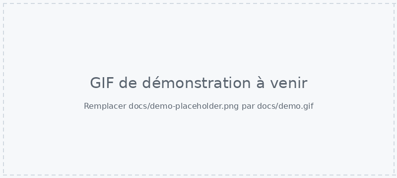

# Project Cockpit

**Un seul panneau, zéro configuration** : lancez les commandes de votre projet, gérez les ports occupés et vérifiez votre `.env`.
Pensé pour les devs **JS/TS** (Vue, Nuxt, Svelte, Angular, NestJS) et **Java** (Maven, Gradle, Spring), dans VS Code et ses dérivés (Cursor, Windsurf, VSCodium).



## Fonctionnalités

Une vue **Cockpit** dans la barre d'activité, avec trois groupes.

### Commandes

Détectées automatiquement, sans rien configurer :

| Source | Commandes proposées |
|---|---|
| `package.json` | chaque script, avec le gestionnaire déduit du lockfile : `pnpm-lock.yaml` → pnpm, `yarn.lock` → yarn, `bun.lock(b)` → bun, sinon npm |
| `pom.xml` | `clean install`, `test`, et `spring-boot:run` si `spring-boot-maven-plugin` est présent (`./mvnw` si le wrapper existe) |
| `build.gradle(.kts)` | `build`, `test`, et `bootRun` si le plugin Spring Boot est appliqué (`./gradlew` si le wrapper existe) |
| `Makefile` | une commande par cible explicite |
| `docker-compose.yml`, `compose.yaml` | `up`, `down`, `logs -f` |

- **Monorepos** : le workspace est parcouru jusqu'à 3 niveaux de profondeur ; `node_modules`, `dist`, `target`, `build` et les dossiers cachés sont ignorés.
- Un clic lance la commande dans **un terminal dédié et nommé** ; boutons **Relancer** et **Stop** ; l'état « en cours » est visible dans l'arbre.

### Ports

Les ports TCP en écoute, avec le nom du processus et le PID (`lsof` sur macOS/Linux, `netstat -ano` sur Windows).

- Les ports **du projet** sont en tête : ceux déclarés dans `.env` (`PORT=`, `*_PORT=`, marqués d'une étoile) et ceux des processus lancés depuis votre workspace (macOS/Linux).
- Par défaut, seuls **vos** processus sont listés ; le bouton de la barre de la vue affiche aussi ceux des autres utilisateurs, en lecture seule.
- **Libérer** : confirmation, puis arrêt propre ; si le processus tourne encore après 3 s, l'arrêt forcé est proposé.
- Rafraîchissement toutes les 5 s, **uniquement quand la vue est visible**.

### Environnement

Compare `.env` à `.env.example` (ou `.env.sample`, `.env.template`) : variables **manquantes**, **vides** et **en trop**.

- Action **Créer .env depuis .env.example** (n'écrase jamais un fichier existant).
- S'il existe plusieurs fichiers `.env*` (`.env.local`, `.env.development`…), un sélecteur choisit celui à comparer.
- **Les valeurs ne sont jamais affichées, journalisées ni transmises.** Seuls les noms de variables et le fait qu'une valeur soit vide sont lus.

## Gratuit et Pro

| Fonction | Gratuit | Pro |
|---|:-:|:-:|
| Commandes (npm/pnpm/yarn/bun, Maven, Gradle, Makefile, compose) et monorepos | ✓ | ✓ |
| Ports : liste, ports du projet, « Libérer » | ✓ | ✓ |
| Environnement : comparaison avec le gabarit, création du `.env` | ✓ | ✓ |
| Profils multi-projets / monorepo | 🔒 | ✓ |
| Historique des ports | 🔒 | ✓ |
| Config d'équipe partagée (`.cockpit.json` versionné dans le dépôt) | 🔒 | ✓ |

Le Pro n'est **pas encore en vente**. Dans la version gratuite, ces trois fonctions apparaissent comme des entrées verrouillées (cadenas + lien vers la page du projet). Le code Pro n'est pas dans ce dépôt : il sera livré comme une extension séparée qui s'appuie sur l'API ci-dessous.

## Installation

Depuis le fichier `.vsix` (page du projet : <https://nikuspokus.github.io/project-cockpit/>, ou onglet *Releases*) :

1. VS Code → panneau Extensions → menu « … » → **Installer à partir de VSIX…**
2. ou en ligne de commande : `code --install-extension project-cockpit-0.1.0.vsix`

L'extension s'active seulement si le workspace contient un des fichiers détectés (`package.json`, `pom.xml`, `build.gradle(.kts)`, `Makefile`, `docker-compose.*`, `compose.*`, `.env`).

## Mise à jour

Installée depuis un `.vsix`, l'extension consulte `latest.json` sur sa page GitHub Pages, propose les nouvelles versions, **vérifie l'empreinte SHA-256** du fichier téléchargé puis l'installe.
Installée depuis un store (VS Marketplace, Open VSX), c'est VS Code qui met à jour : la vérification intégrée est alors inactive.

## Réglages

| Réglage | Défaut | Rôle |
|---|---|---|
| `cockpit.checkUpdates` | `true` | Vérification de mise à jour (installation `.vsix` uniquement) |
| `cockpit.licenseKey` | vide | Clé de licence Pro (aucune validation réseau pour l'instant) |

Variable d'environnement : `COCKPIT_UPDATE_CHECK=off` coupe la vérification de mise à jour.

## Confidentialité et sécurité

- **Aucune télémétrie.** Le seul appel réseau est la vérification de mise à jour (`latest.json`), sans donnée personnelle.
- Les valeurs de vos `.env` ne sont jamais affichées ni stockées ; seuls les numéros de port (`PORT`, `*_PORT`) sont retenus pour repérer les ports du projet.
- Les commandes externes (`lsof`, `netstat`, `taskkill`…) sont lancées **sans shell**, avec des arguments fixes.
- « Libérer » ne propose que les processus de l'utilisateur courant, revérifie le port juste avant d'agir, et refuse d'arrêter le PID 1 ou l'hôte d'extensions.

## Limites connues

- macOS/Linux : `lsof` doit être installé (le message d'erreur l'indique sinon).
- Windows : le dossier de travail des processus n'est pas disponible, donc seuls les ports du `.env` sont mis en avant ; les commandes `./mvnw` et `./gradlew` supposent PowerShell ou un shell compatible.
- Les scripts npm dont le nom contient des caractères spéciaux (espaces, `;`…) sont ignorés par sécurité.

## API pour l'extension Pro

`activate()` renvoie un objet `CockpitApi` (voir [`src/api.ts`](src/api.ts)) : projets détectés, service de licence et `registerProFeature()`.

```ts
const api = await vscode.extensions.getExtension('nikuspokus.project-cockpit')?.activate();
api.registerProFeature({
  id: 'profiles', // 'profiles' | 'port-history' | 'team-config'
  getItems: () => [{ id: 'p1', label: 'Mon profil', icon: 'rocket' }],
});
```

L'entrée verrouillée est remplacée par les éléments de l'extension Pro quand elle est installée **et** que `license.isPro()` est vrai.
La validation de licence réelle (API du revendeur « Merchant of Record », cache hors-ligne, délai de grâce de 7 jours) est décrite en TODO dans [`src/pro/license.ts`](src/pro/license.ts).

## Développement

Prérequis : Node.js 22+ et VS Code 1.90+.

```bash
npm install
npm run typecheck   # vérification des types (tsc)
npm test            # tests Vitest : détecteurs, scan, ports, environnement, licence, mise à jour
npm run build       # bundle esbuild → dist/extension.js
npm run package     # produit project-cockpit-<version>.vsix
```

**Tester dans VS Code (F5)** : ouvrez ce dossier dans VS Code, lancez la configuration « Lancer l'extension (Extension Development Host) » avec **F5**.
Une seconde fenêtre VS Code de test s'ouvre : ouvrez-y un dossier de projet (*Fichier → Ouvrir le dossier…*) et cliquez sur l'icône **Cockpit** de la barre d'activité.
Un dossier d'essai est fourni : `test/fixtures/monorepo`.

Structure : détecteurs purs dans `src/detectors/` (contenu de fichier → commandes, sans import `vscode`), accès OS isolé dans `src/platform/`, interface dans `src/views/`.

Mise en ligne (tag, GitHub Pages, tokens des stores) : [docs/PUBLISHING.md](docs/PUBLISHING.md).

## Licence

Tous droits réservés — voir [LICENSE](LICENSE). Le code source est visible pour la transparence, sans autorisation de réutilisation.
